# 📚 The Book Atelier - Laravel Edition

Versi modern dari aplikasi toko buku online **The Book Atelier** yang dibangun menggunakan framework **Laravel 11**, **MySQL**, **PHP 8.3**, dan **Bootstrap 5.3**.

> 🌐 **Live Preview Landing Page (GitHub Pages):**  
> 👉 [**https://veltros.github.io/BookStoreTo1/**](https://veltros.github.io/BookStoreTo1/)  
> *(Halaman antarmuka beranda resmi dapat dibuka langsung 24/7 di browser tanpa perlu hosting luar)*

> 📸 **Galeri Lengkap 14 Tangkapan Layar:**  
> 👉 [**https://github.com/Veltros/BookStoreTo1/blob/main/screenshots/README.md**](https://github.com/Veltros/BookStoreTo1/blob/main/screenshots/README.md)

---

## 📸 Preview Tampilan Website

| 🛍️ Halaman Beranda (Katalog Buku) | 📖 Detail Buku & Tombol Beli |
| :---: | :---: |
| [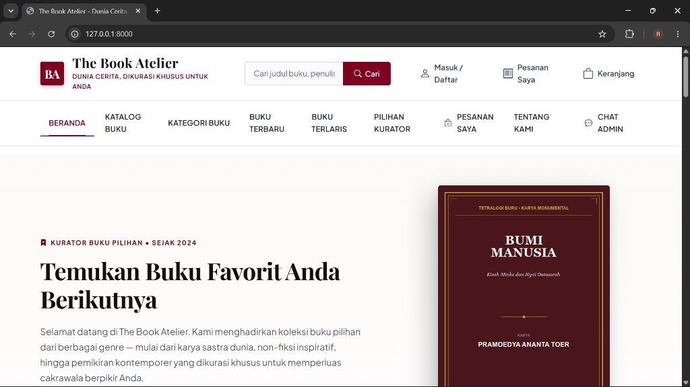](https://github.com/Veltros/BookStoreTo1/blob/main/screenshots/01_home_beranda.jpg) | [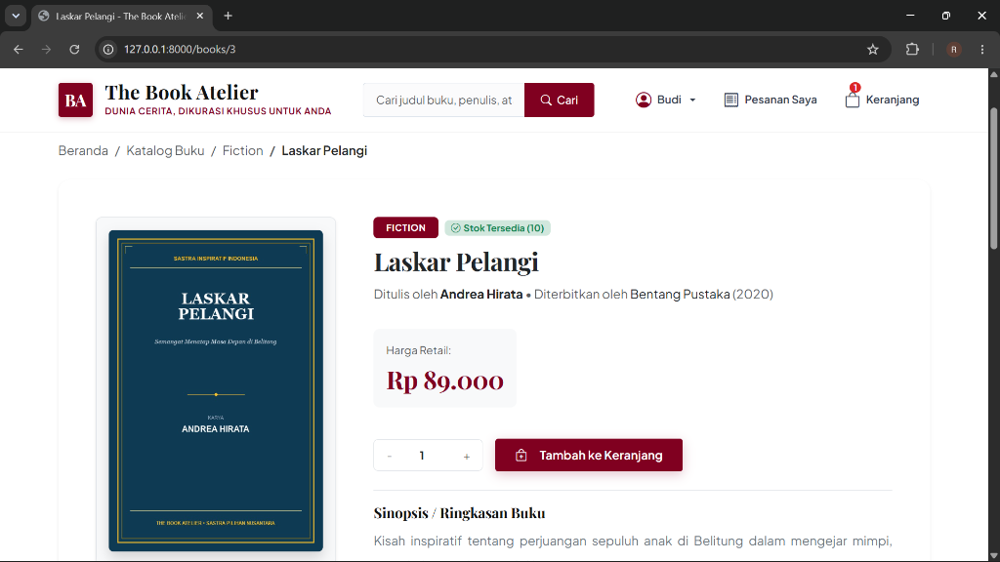](https://github.com/Veltros/BookStoreTo1/blob/main/screenshots/02_detail_buku.png) |

| 🛒 Keranjang Belanja & Seleksi Beli | 📊 Dasbor Manajemen Administrator |
| :---: | :---: |
| [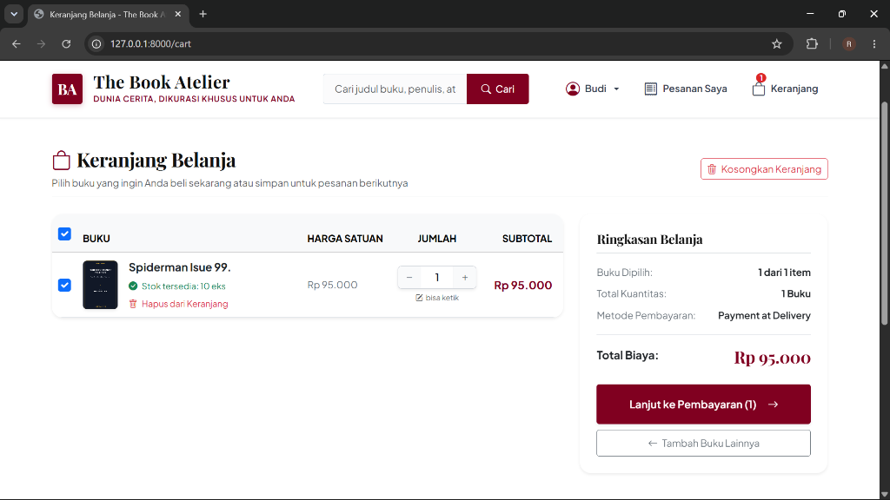](https://github.com/Veltros/BookStoreTo1/blob/main/screenshots/03_keranjang_belanja.png) | [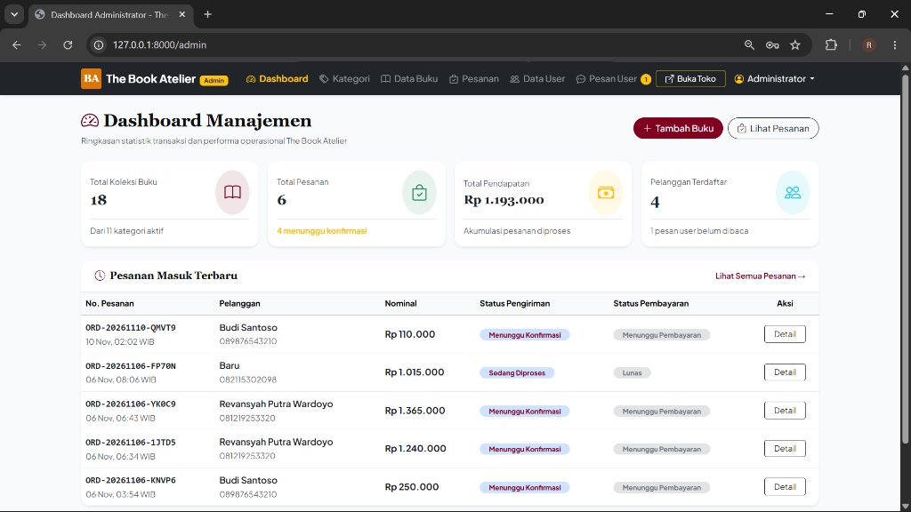](https://github.com/Veltros/BookStoreTo1/blob/main/screenshots/09_admin_dashboard.jpg) |

<b>🔍 Klik di sini untuk melihat preview antarmuka lainnya (Pesanan, Chat, & Panel Admin)</b>

 

| 📦 Riwayat Pesanan Pelanggan | 💬 Layanan Chat Concierge |
| :---: | :---: |
| [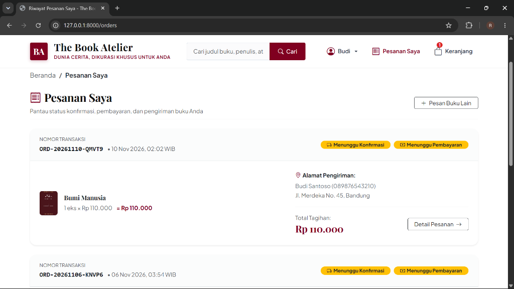](https://github.com/Veltros/BookStoreTo1/blob/main/screenshots/04_riwayat_pesanan.png) | [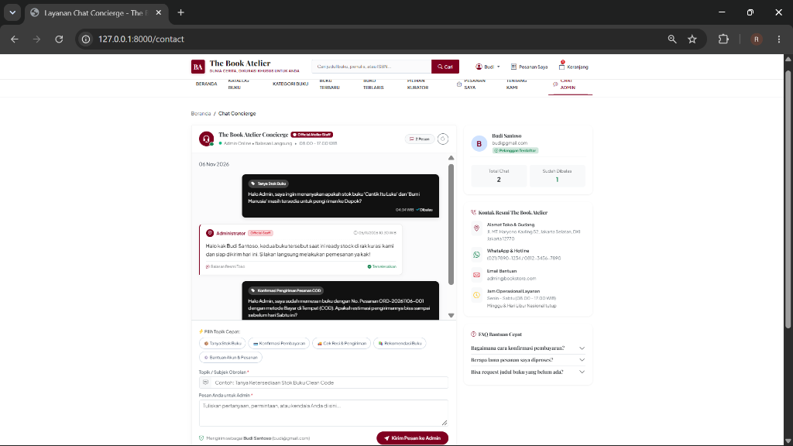](https://github.com/Veltros/BookStoreTo1/blob/main/screenshots/05_chat_concierge.png) |

| 📚 Kelola Data Buku (Admin) | 🏷️ Kelola Kategori (Admin) |
| :---: | :---: |
| [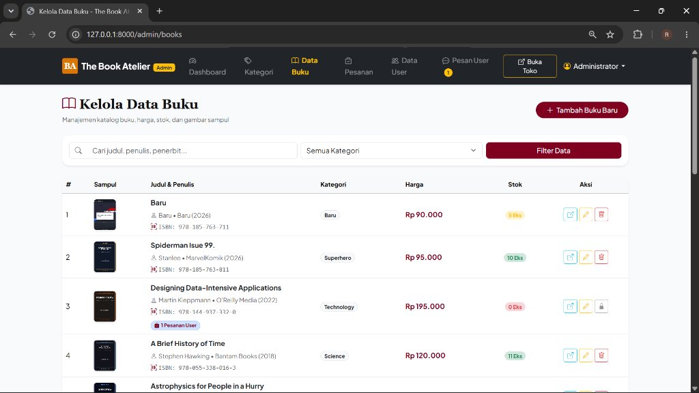](https://github.com/Veltros/BookStoreTo1/blob/main/screenshots/10_admin_kelola_buku.jpg) | [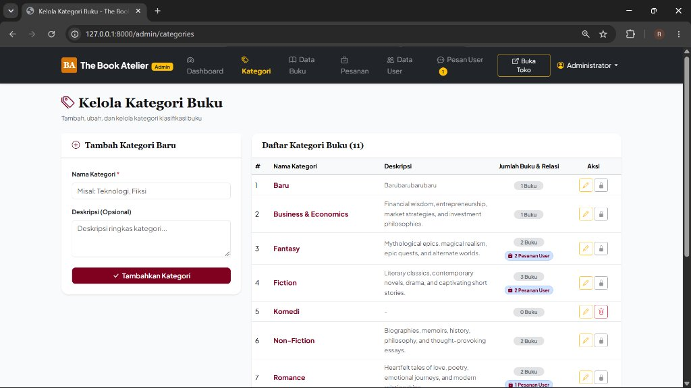](https://github.com/Veltros/BookStoreTo1/blob/main/screenshots/11_admin_kelola_kategori.jpg) |

| 📋 Manajemen Pesanan (Admin) | 👥 Data Pengguna Terdaftar (Admin) |
| :---: | :---: |
| [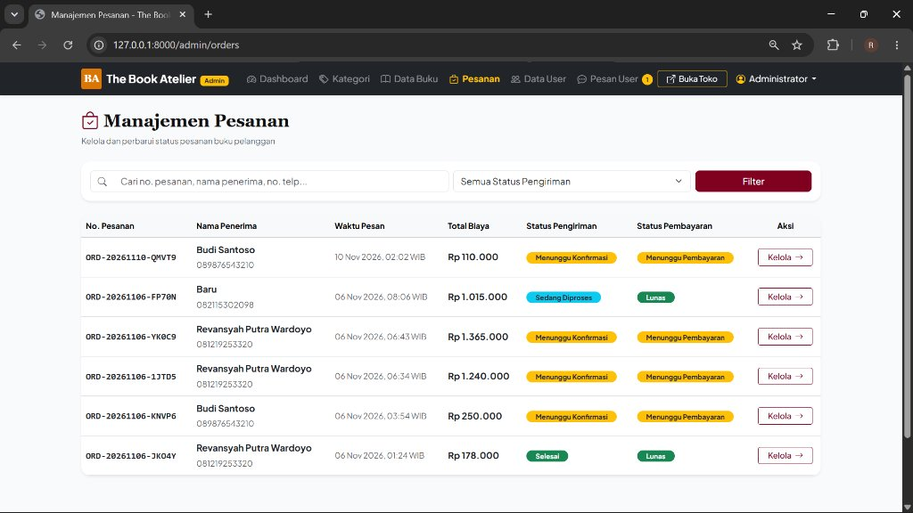](https://github.com/Veltros/BookStoreTo1/blob/main/screenshots/12_admin_manajemen_pesanan.jpg) | [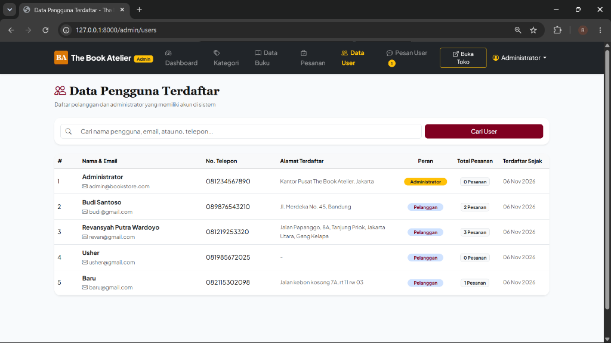](https://github.com/Veltros/BookStoreTo1/blob/main/screenshots/13_admin_data_pengguna.png) |

| 🔐 Form Masuk (Login) | 📝 Registrasi Akun Baru |
| :---: | :---: |
| [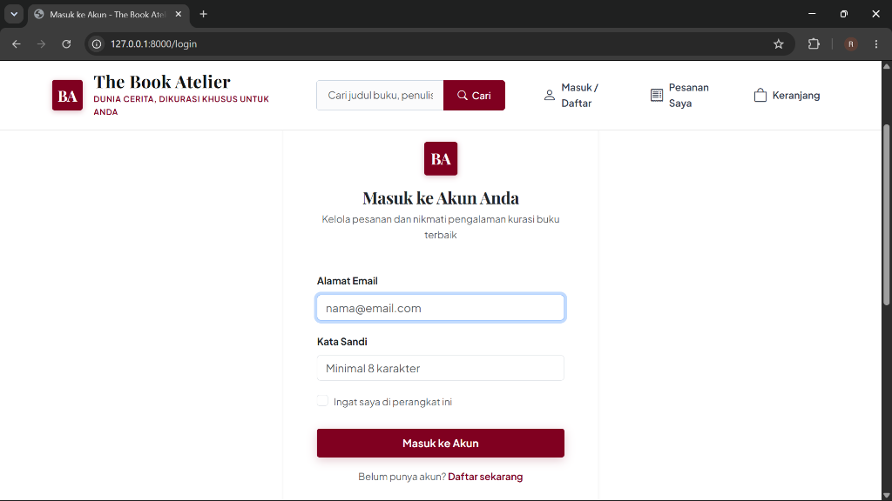](https://github.com/Veltros/BookStoreTo1/blob/main/screenshots/07_masuk_login.png) | [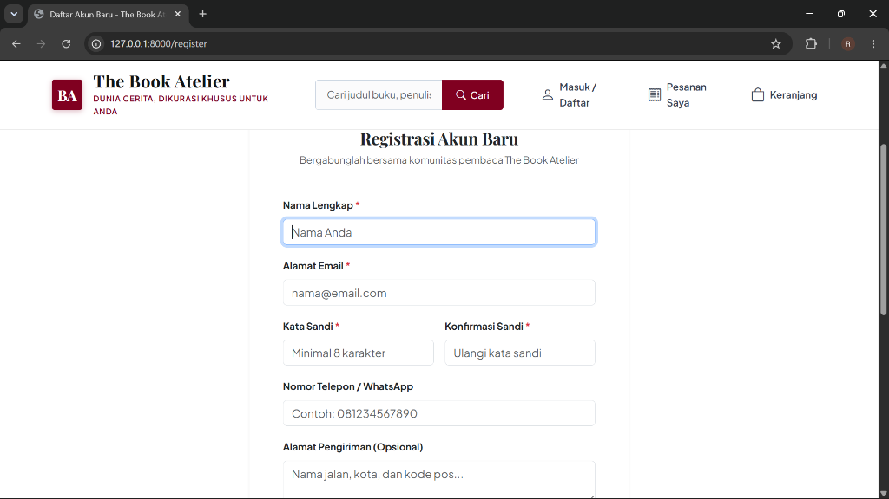](https://github.com/Veltros/BookStoreTo1/blob/main/screenshots/08_registrasi_akun.png) |

👉 **Lihat Galeri 14 Tangkapan Layar Lengkap:** [**`screenshots/README.md`**](https://github.com/Veltros/BookStoreTo1/blob/main/screenshots/README.md)

---

## 🚀 Fitur & Arsitektur Sistem

1. **Arsitektur MVC (Model-View-Controller)**:
   - **Models & Relasi Eloquent:** `User`, `Category`, `Book`, `Order`, `OrderItem`, `Message`, `CartItem`.
   - **Controllers Terstruktur:** Pemisahan controller publik (`HomeController`, `BookController`, `CartController`, `OrderController`, dll) dan panel admin (`Admin\BookController`, `Admin\CategoryController`, dll).
   - **Blade Templates:** Komponen modular dengan layout terpadu (`layouts/app.blade.php` dan `layouts/admin.blade.php`).

2. **Integritas & Proteksi Data Transaksi**:
   - Buku dan Kategori yang terhubung dengan riwayat pesanan user **tidak dapat dihapus** (`ON DELETE RESTRICT` pada basis data dan proteksi keamanan di controller).
   - Indikator gembok 🔒 dan lencana pesanan user aktif di tabel admin.

3. **Sistem Keranjang & Checkout Transaksional**:
   - Validasi stok sebelum checkout menggunakan *pessimistic locking* (`lockForUpdate`).
   - Kontrol transaksi database aman (`DB::transaction`) untuk memastikan pemotongan stok dan pembuatan nomor pesanan `ORD-YYYYMMDD-XXXXX` berjalan atomik (*all-or-nothing*).
   - Fitur seleksi checkout (ceklis item) dan stepper kuantitas manual.

4. **Autentikasi & Otorisasi Berbasis Peran (RBAC)**:
   - Sistem login aman dengan hashing kata sandi bawaan Laravel BCRYPT.
   - Route Middleware: `auth` untuk transaksi pelanggan dan `admin` untuk panel manajemen.
   - Proteksi respon **HTTP 401 Unauthorized** (jika belum login) dan **HTTP 403 Forbidden** (jika peran tidak berhak), dengan halaman error kustom yang bersih (*minimalist*).

5. **Layanan Concierge Dua Arah**:
   - Pengguna dapat mengirimkan pesan ke pengelola toko via obrolan berbalas.
   - Admin dapat membalas pesan dan riwayat balasan langsung muncul di akun pengguna.

---

## 🔑 Akun Demo Pengujian

| Peran (Role) | Alamat Email | Kata Sandi | Halaman Akses |
| :--- | :--- | :--- | :--- |
| **Admin** | `admin@bookstore.com` | `admin123` | `/admin` |
| **User (Pelanggan)** | `budi@gmail.com` | `user1234` | `/` |

---

## 🌐 Cara Menjalankan di Laragon

1. Pastikan Laragon berjalan (**Start All** Apache & MySQL).
2. Database MySQL: `bookstore_laravel_db` (sudah ter-migrasi dan ter-seeding secara otomatis).
3. Akses via Browser:
   - 👉 **`http://bookstore-laravel.test`**  
   - Atau via localhost:  
     👉 **`http://localhost/bookstore-laravel/public`**
   - Panel Admin:  
     👉 **`http://localhost/bookstore-laravel/public/admin`**
