# 📸 Screenshots & Web Previews - The Book Atelier

Dokumentasi tangkapan layar tampilan antarmuka (UI/UX) website **The Book Atelier** (Laravel 11).

---

## 🛍️ Antarmuka Pelanggan & Publik

### 1. Halaman Beranda & Rekomendasi Buku
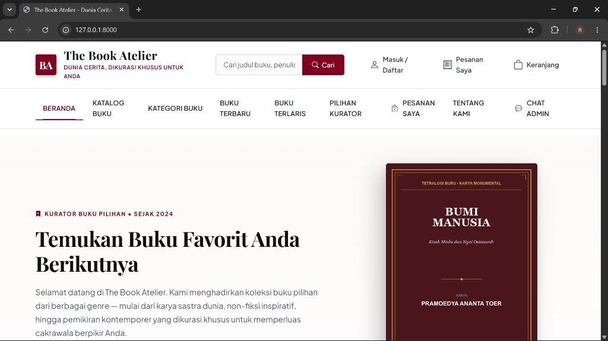

### 2. Detail Informasi & Sinopsis Buku
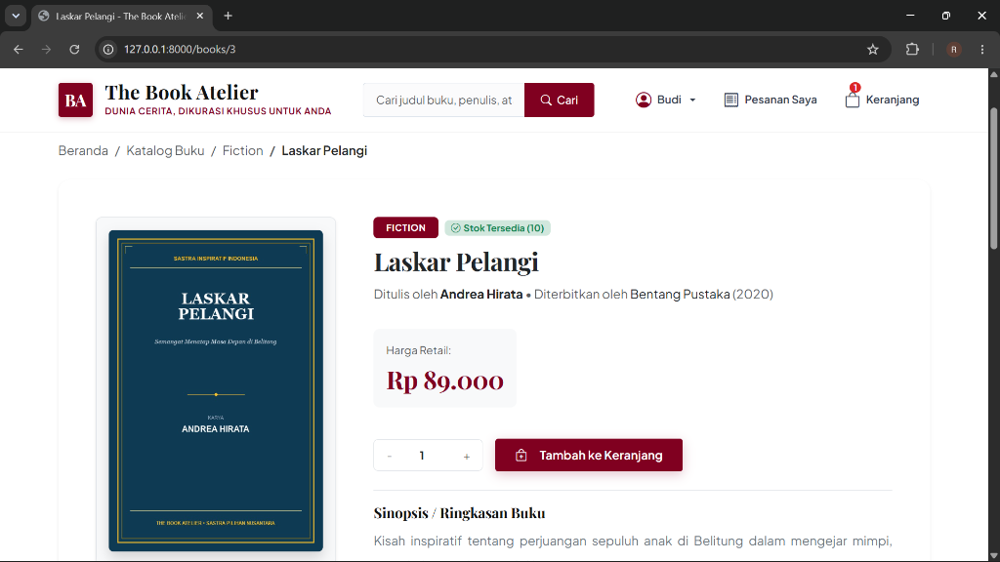

### 3. Keranjang Belanja & Stepper Kuantitas
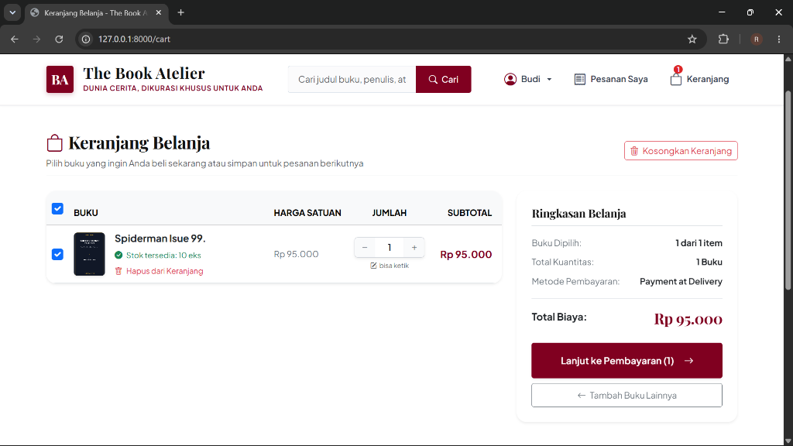

### 4. Riwayat Pesanan Pelanggan
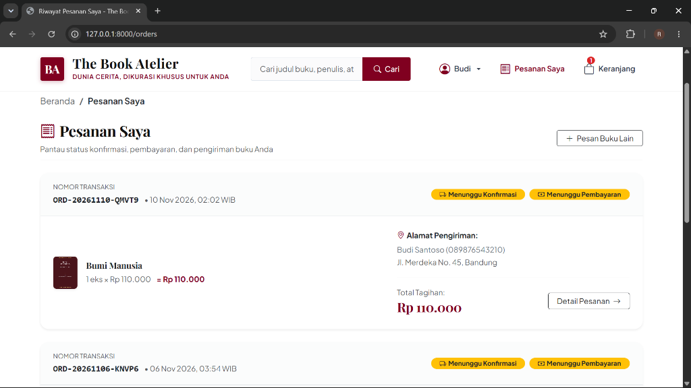

### 5. Layanan Chat Concierge Dua Arah
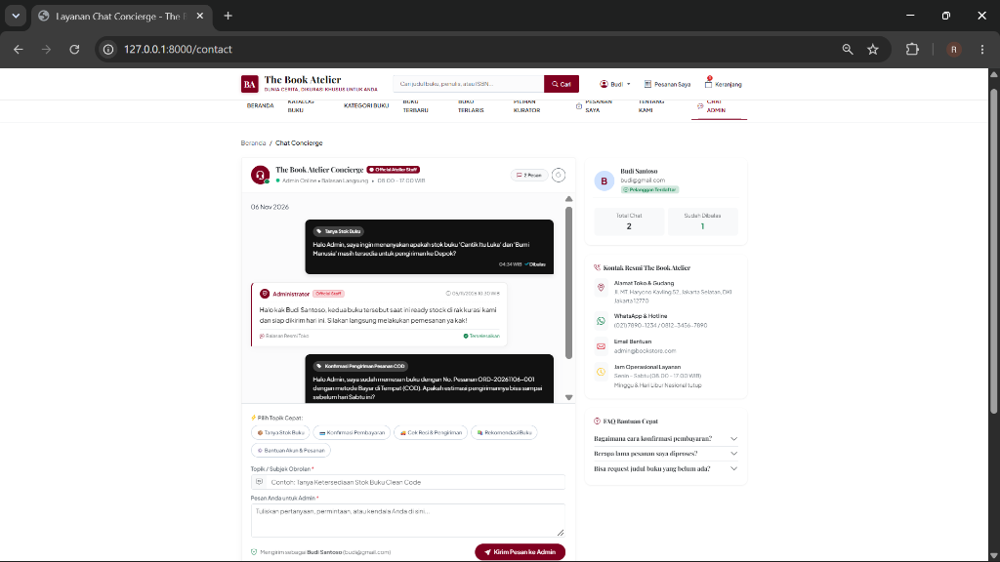

### 6. Halaman Tentang Kami
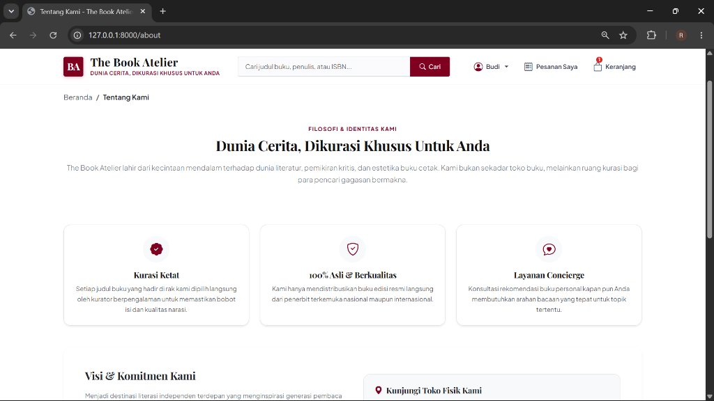

### 7. Form Masuk ke Akun (Login)
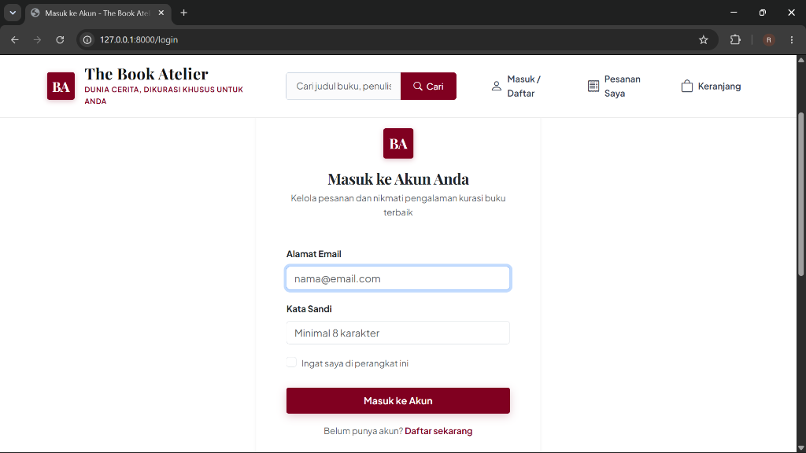

### 8. Form Registrasi Akun Baru
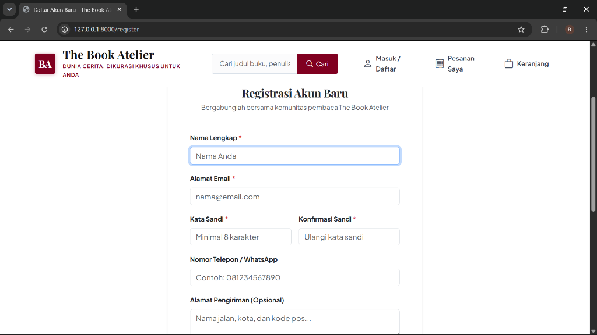

---

## ⚙️ Panel Manajemen Administrator

### 9. Dasbor Administrator & Ringkasan Statistik
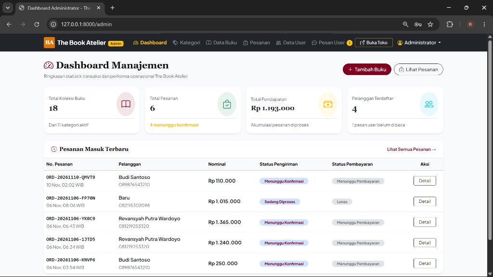

### 10. Kelola Data Buku (Katalog, Harga, & Stok)
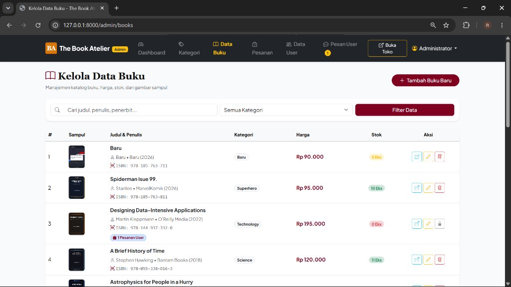

### 11. Kelola Kategori Buku
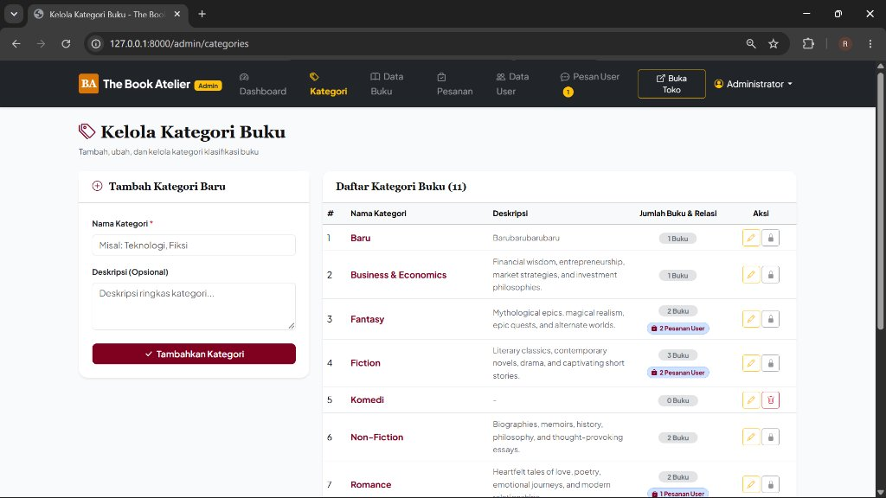

### 12. Manajemen & Pembaruan Status Pesanan
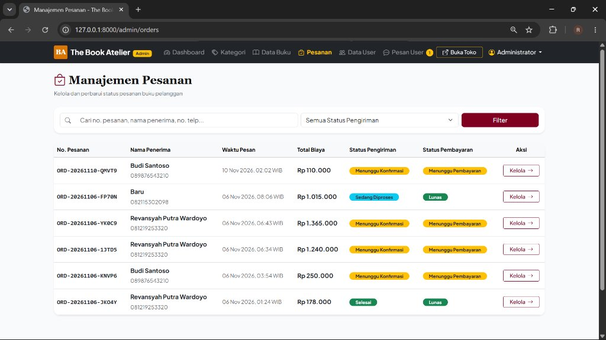

### 13. Data Pengguna Terdaftar
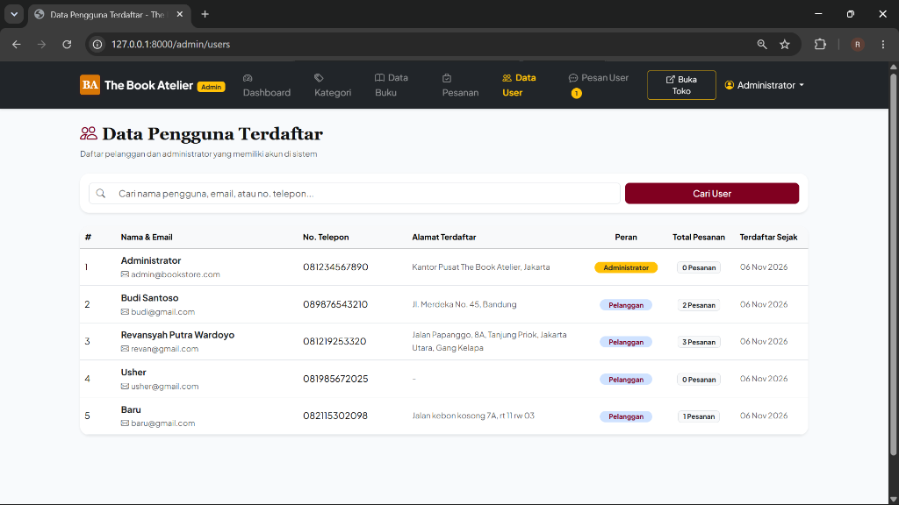

### 14. Kelola Pesan Chat Pengguna
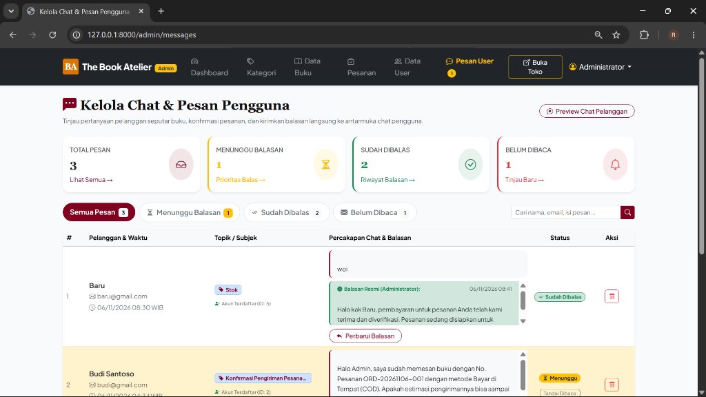
